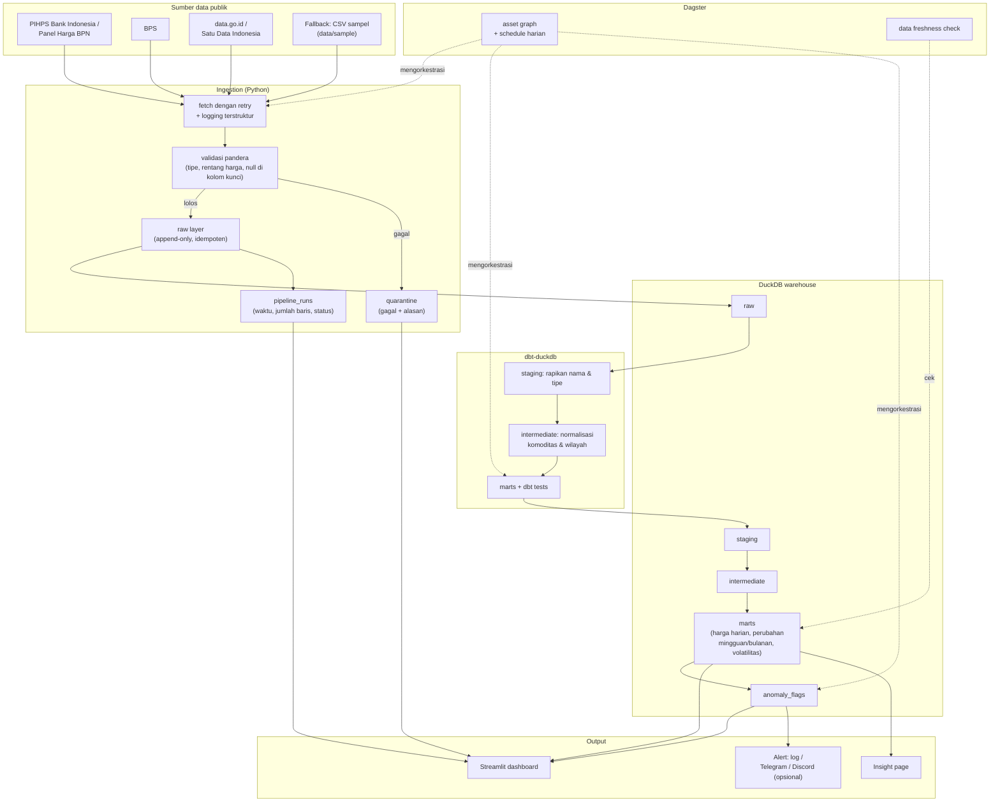

# Arsitektur — harga-pangan-pipeline

Diagram ini menggambarkan alur data dari sumber publik hingga dashboard dan
alert. Sebagian komponen baru akan diimplementasikan pada fase berikutnya;
diagram ini menjadi acuan target.

## Alur ringkas

1. **Ingestion** mengambil data dari sumber publik (dengan retry). Jika tidak
   bisa diakses otomatis, gunakan CSV sampel dari `data/sample/`.
2. **Validasi pandera** memisahkan data bersih (masuk `raw`) dari data buruk
   (masuk `quarantine` beserta alasannya). Setiap run dicatat di `pipeline_runs`.
3. **dbt** mengubah `raw` menjadi `staging` → `intermediate` → `marts`, dengan
   dbt tests sebagai gerbang kualitas.
4. **Deteksi anomali** menulis flag ke `anomaly_flags`.
5. **Dagster** mengorkestrasi seluruh langkah dengan schedule harian dan
   freshness check.
6. **Streamlit** menampilkan tren, anomali, ringkasan kualitas data, dan insight.
7. **Alert** (opsional) dikirim via log/Telegram/Discord.
